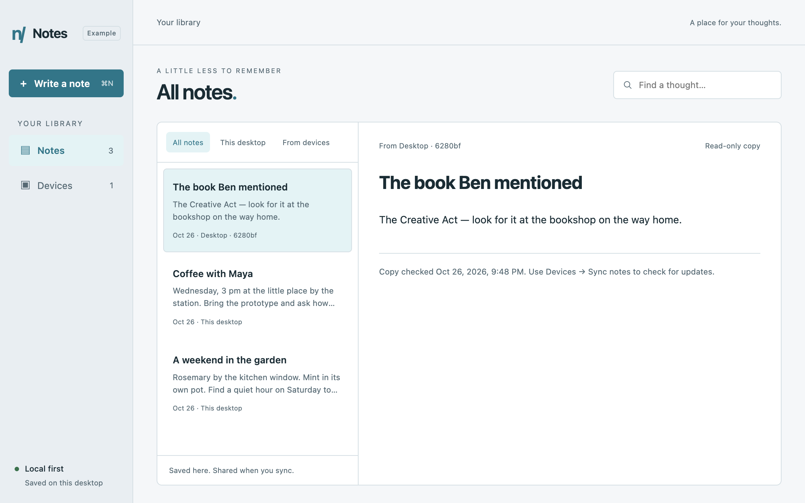

# Notes — desktop example

A small, real desktop app for writing, browsing and syncing text notes. Built on
Electron/Pear with storage and P2P in a native Bare worker. No account or model
download is needed to write and read your notes.



## Start the app

Use Node 22.17+. Install and run from this folder, independently of stack packages:

```sh
npm ci
npm run dev
```

Or from the repository root:

```sh
npm ci --prefix examples/unstoppable-notes
npm --prefix examples/unstoppable-notes run dev
```

Write a note, give it a title if you like, and choose **Save note**. Browse the
list, search by title or text, or use **This desktop / From devices** filters.
Select an original to edit it, then **Save changes**. Received copies are
read-only. Local notes and downloaded copies survive a full restart without
another device. System light/dark appearance, keyboard focus, narrower layouts,
and Cmd/Ctrl+N, Cmd/Ctrl+S and Cmd/Ctrl+F are supported.

This is an experimental developer example, not a packaged consumer release.
macOS native behavior is tested separately from Node-only checks. Linux/Windows
packaged acceptance and actual public-network/two-computer tests remain separate
gates. Do not infer them from a build or two local windows.

## Pair two desktops

1. On desktop A, open **Devices → Create pairing code**.
2. Privately copy that one-use code to your other trusted desktop.
3. On desktop B, open **Devices**, paste it, then choose **Pair & sync**.
4. Later, choose **Sync notes** from either desktop. Keep both apps running and
   online until it finishes. No new invitation is needed after a restart.

One sync exchanges both devices’ current original notebooks and saves received
copies locally. Each original belongs to its writing device; edit it there and
sync again to update the other device. Copies are labeled with their source and
last checked time. A live connection is not proof that every note is current.
Unsaved drafts stay local and are not included in an exchange.

Invitations expire after 15 minutes and have one use. Creating another code
revokes the previous code from this app session. Unknown peers are denied;
remembered peers reconnect with their saved identities and existing grants.
**Pairing grants access to all saved originals**, not selected notes. The UI
clears a used code. Keep your local storage/identity private. No peer revocation
UI, encrypted local-storage management or backup guarantee is provided here.

You can try two separate local profiles before using separate computers:

```sh
npm run dev -- --storage /tmp/notes-example-a --user-data-dir=/tmp/notes-example-browser-a
# In a second terminal:
npm run dev -- --storage /tmp/notes-example-b --user-data-dir=/tmp/notes-example-browser-b
```

These manual profiles use normal public discovery. Use a distinct directory for
every running app. Default data lives under Electron’s app-specific user-data
folder; no private product app profile is read. To end a desktop session on macOS,
quit the app, not just its window.

## How it works

- `electron/main.js` embeds `pear-runtime`; context-isolated preload/IPC exposes
  only the Notes operations. The renderer does not load native storage/networking.
- `worker.js` owns the runtime and `src/notebook.js` owns app storage and sync policy.
- A local Hyperbee stores originals and per-device received snapshots. The app
  does **not** replicate that private store or forward other devices’ copies.
- Published `@unstoppable-stack/p2p@0.6.0-alpha.4` owns discovery, encrypted
  transport, persistent identities, scoped invitations and capability calls.
- The app’s sole remote capability is `notebook.exchange`. It validates bounded
  text snapshots and uses the authenticated sender as owner. Both sides durably
  save received copies; the caller verifies an acknowledgement of its revision.
- Revisions and canonical snapshots make this specific exchange idempotent.
  Only transient connection failures are retried within a 45-second operation
  deadline; Cancel stops the attempt without removing saved notes. This is app
  snapshot sync through RPC, not Hypercore/Hyperdrive mirroring or a general
  retry policy for arbitrary remote actions.

Each desktop is one writer, limited to 100 notes, 10,000 characters per note and
240 KB per notebook snapshot. There is no collaborative text editing, deletion
UI, automatic/background sync, attachments, recording, AI, calendar integration
or store installer. No relay fallback for networks that block UDP is promised.
The example has its own notebook schema and device protocol; pairing is between
instances of this example.

The host originated from CLI `0.4.0-beta.4`’s desktop scaffold without AI features.
`.unstoppable/project.json` preserves that provenance and the intentional P2P
alpha.4 pin. An older installed CLI may propose reverting that pin to alpha.3;
keep this intentional app change rather than applying a downgrade. App colors are generated from the stack’s canonical UI tokens by
`scripts/sync-stack-assets.mjs`. Do not force-regenerate edited app source.

## Validation

```sh
npm test             # Real native Node peers on an isolated loopback DHT
npm run test:ui      # Two real Electron/Pear/Bare apps with temporary profiles
npm run demo:script  # Original managed-JSON command-line demonstration
```

The backend tests cover persistence, mutual scoped access, invalid input,
read-only copies, no forwarding, both directions after restart, a real transport
loss, cancellation and fresh content after reconnect. The desktop test drives
writing/editing, browsing/search, pairing, fresh bidirectional sync, preserving
an unsaved draft, safe text rendering, source-offline restart, cancellation and
reconnect without re-pairing. It also captures light/dark, Devices and narrow
screenshots. All notes and profiles used by tests are synthetic and temporary;
artifacts stay ignored. The CI UI job runs on macOS.

These checks do not qualify cross-network NAT traversal, physical devices,
packaged distribution or backups. See [runtime validation](../../docs/validation.md).
For other data patterns, see [managed JSON](../p2p-data/README.md) and
[capability calls and replication](../p2p-notes/README.md).
